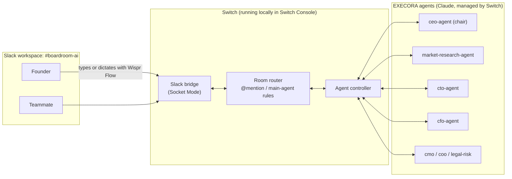
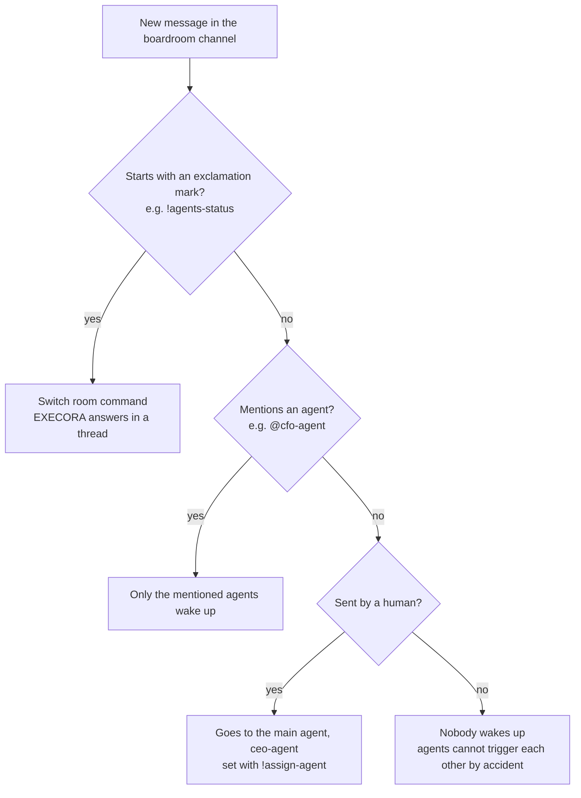
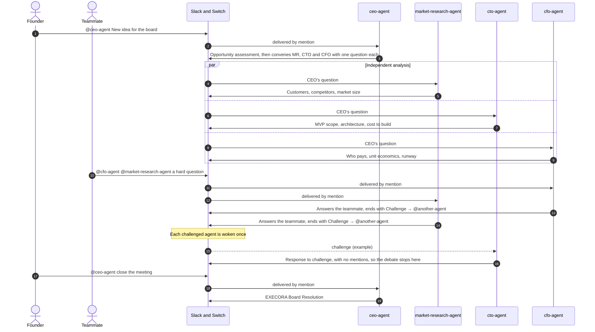
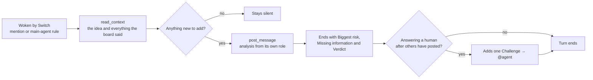

# EXECORA: an AI boardroom that lives in Slack

EXECORA gives a founder a full executive board in a Slack channel. You post a startup idea in `#boardroom-ai`. A CEO, a market researcher, a CTO, a CFO and other AI executives analyse it from their own angle, challenge one another's assumptions, take questions from your human teammates, and end with a board resolution you can act on.

There is **no custom frontend, no custom backend and no hosted infrastructure**. EXECORA is built entirely from:

- **Slack**: the shared room where humans and agents talk.
- **Switch**: the agent collaboration layer. It runs the agents, bridges them into Slack and routes every message.
- **Configuration**: the agent instructions and room settings in this repository.

## The problem

Early-stage founders make their biggest decisions alone or with a single chatbot. A single chatbot tends to agree with you and gives one blended answer. What a founder needs is the friction of a real board: a CFO who asks who actually pays, a CTO who says the MVP is too big, a researcher who names the competitor you forgot. EXECORA puts that friction where the team already works, in Slack, and keeps humans in the conversation instead of handing them a report.

## How it works



1. A person posts in `#boardroom-ai`. Wispr Flow lets them speak instead of type.
2. The EXECORA Slack app receives the message over Socket Mode and hands it to Switch.
3. Switch's router decides who it is for:
   - Every agent named with an @mention, e.g. `@cfo-agent`, is woken.
   - A human message that mentions nobody goes to the room's main agent, `@ceo-agent`.
   - Agent posts only wake agents they explicitly mention, so agents cannot set each other off by accident.
4. Each woken agent reads the room with Switch's `read_context` tool, then replies with `post_message`. Its reply appears in Slack under its own name, marked as an agent. When it needs a specific colleague to act, it uses `send_targeted_message` or an @mention.
5. The CEO Agent opens the meeting, chairs it and closes it with a board resolution.

### Who hears a message

Switch decides, for every message in the channel, which agents wake up. This is what keeps the room free of duplicate replies and runaway agent loops.



### A meeting, step by step



## Why Switch

- **Agents are real participants.** Each executive is a separate long-running Claude session with its own role and memory of the discussion, not one model pretending to be seven.
- **One room, many agents, many humans.** Switch puts every agent and every human into the same room and mirrors it into Slack, so the debate is visible and anyone can join in.
- **Routing and safety are built in.** Switch handles @mention routing, a main agent for un-addressed messages, per-agent sessions, reconnects, Slack rate-limit back-off, and room commands such as `!agents-status`, `!reset` and `!interrupt`.
- **No code to host.** Everything an agent can do is configured in Switch Console, so the whole product is reproducible from this repository's instructions.

## The board

| Agent (Switch name) | Role | The question it answers |
|---|---|---|
| `ceo-agent` | Chair. Business opportunity, runs the meeting, final decision | Is this a business worth building, and what is the board's verdict? |
| `market-research-agent` | Customers, market size, competitors | Is there a real, reachable market, and can we beat today's alternatives? |
| `cto-agent` | Technical feasibility | Can a small team build it, how fast, at what cost, and what could break? |
| `cfo-agent` | Monetisation and runway | Who pays, what are the unit economics, and does the cash last? |
| `cmo-agent` | Go-to-market | How do we reach the first users and win them? |
| `coo-agent` | Execution | Can this team deliver it, in what order, with whom? |
| `legal-risk-agent` | Legal, privacy, regulatory and trust risk | What could hurt us legally, and what must exist before launch? |

Each agent's full instructions are in [`switch/agents/`](switch/agents/): a role section, followed by the shared [EXECORA Boardroom Protocol](switch/agents/_boardroom-protocol.md). The protocol is what turns seven chatbots into a board:

- **Read before you speak.** Every agent calls `read_context` first and never repeats a colleague's point.
- **Be specific.** Every post names the real segments, competitors, technologies and numbers for this idea. Every number is labelled Fact, Estimate or Assumption.
- **Name what's missing.** Every post ends with *Biggest risk*, *Missing information* and *Verdict*.
- **Debate by design.** When an agent answers a human's question, it must end with one `Challenge → @agent` aimed at another executive's weakest assumption. The challenged agent replies once (`Response to challenge —`) without mentioning anyone, and the CEO settles what is left. This keeps debate real and bounded, with no infinite agent loops.
- **No noise.** No broadcast @mentions, no "standing by" acknowledgements, at most one agent mention per post (only the CEO, when convening, mentions several).
- **Humans first.** A founder's or teammate's question is answered in the first line.

Every time Switch wakes an agent, it follows the same turn:



## How humans take part

- **Founder:** brings the idea (`@ceo-agent …`), answers the board's questions, and asks the CEO to close the meeting.
- **Teammates:** anyone in `#boardroom-ai` can question any executive by @mentioning it, or post without a mention to reach the chair.
- **Voice with Wispr Flow:** with Wispr Flow running, hold its dictation hotkey while the Slack message box is focused and speak. Your words arrive as an ordinary Slack message, so pitching to the board feels like talking in a boardroom. Wispr Flow needs no integration work: it only types into Slack, and Switch sees a normal message.

## Set it up

### What you need

| Item | Used for |
|---|---|
| A Slack workspace where you can install apps | The boardroom channel |
| Switch Console (tested with 0.40.1, Switch core 0.31.0), running a local Switch server | Runs and routes the agents |
| Claude Code installed and signed in on the same machine | The agents' model provider in Switch |
| Wispr Flow (optional) | Voice input in Slack |

### 1. Start Switch

Install and open Switch Console and let it start its local Switch server. Check that the provider check shows **Claude** as installed and signed in.

### 2. Create and connect the Slack app

Create a Slack app for EXECORA, enable **Socket Mode**, and connect it from Switch Console's Slack connection screen. Switch needs:

- **Bot token** (`xoxb-…`) with these bot scopes, taken from Switch's own Slack bridge:
  `files:read`, `files:write`, `assistant:write`, `channels:history`, `channels:manage`, `channels:read`, `chat:write`, `chat:write.customize`, `commands`, `groups:history`, `groups:read`, `groups:write`, `im:history`, `im:read`, `im:write`, `mpim:history`, `reactions:read`, `reactions:write`, `users:read`, `usergroups:read`, `usergroups:write`
- **App-level token** (`xapp-…`) with `connections:write`. Socket Mode uses it, so Switch needs no public URL.
- **Event subscriptions** for messages in channels, private channels and DMs (`message.channels`, `message.groups`, `message.im`, `message.mpim`), plus `member_joined_channel`.

`chat:write.customize` lets each agent post under its own name. `usergroups:read` and `usergroups:write` give every agent a Slack user group, so `@ceo-agent` autocompletes in the message box. Without them, agents still work, but you must type their handles exactly.

Tokens are pasted into Switch Console only. They are never stored in this repository.

### 3. Create the agents in Switch

In Switch Console, create one agent per file in [`switch/agents/`](switch/agents/). Use the file name without `.md` as the agent name (for example `ceo-agent`), choose the **Claude** provider, and paste the whole file into the agent's instructions.

### 4. Set up the channel

1. In Switch Console, create a room for the board, link it to the Slack channel `#boardroom-ai`, and add the seven agents. Each agent posts a short greeting when it joins.
2. In Slack, add your teammates to `#boardroom-ai` (`/invite @name`). A late agent can be added from the channel with `!invite-agent @agent-name`.
3. Post these room commands in the channel:

```text
!follow-ups off
!assign-agent @ceo-agent
```

- `!follow-ups off`: an agent only answers when it is mentioned, so a stray message never wakes the wrong executive.
- `!assign-agent @ceo-agent`: a human message that mentions nobody goes to the chair instead of being ignored.

4. Check the setup: `!list-agents` should show all seven agents, and `!agents-status` should show them online.

## Run the demo

Follow [`demo/DEMO-SCRIPT.md`](demo/DEMO-SCRIPT.md). It has the exact three messages and a three-minute run of show:

1. The founder submits the idea to `@ceo-agent`.
2. The CEO assesses the opportunity and convenes Market Research, the CTO and the CFO.
3. Each executive posts its analysis.
4. A teammate asks a hard question.
5. The relevant agents answer and challenge each other.
6. The CEO posts the final board resolution.

## Permissions and credentials

| Credential | Where it lives | Who needs it |
|---|---|---|
| Slack bot token and app-level token | Switch Console's Slack connection | The person who installs the Slack app |
| Claude sign-in | Claude Code on the machine that runs Switch | The agents, through Switch |
| Switch server secrets | Created and stored locally by Switch Console | No one; never copy them out |

Never commit tokens, `.env` files or Switch's local data folders. This repository contains only instructions and documentation.

## Room commands worth knowing

| Command | What it does |
|---|---|
| `!list-agents` | List the agents in the room |
| `!agents-status` | Show which agents are online |
| `!reset @agent` | Clear one agent's context and reconnect it |
| `!interrupt @agent` | Stop an agent's current turn |
| `!invite-agent @agent` / `!remove-agent @agent` | Add an agent to the room or remove it |
| `!assign-agent @agent` / `!unassign-agent` | Set or clear the room's main agent |
| `!follow-ups on` / `!follow-ups off` | Let agents follow a conversation without being mentioned, or not |

## Known limitations

- Switch runs on the founder's machine in this setup. If the laptop sleeps or loses its network, agents pause, and Switch reconnects to Slack when the network returns.
- Agents answer in parallel when convened together, so their order in Slack varies from run to run.
- The first message to a sleeping agent shows Switch's "Starting a session…" notice before the real reply.
- Market facts come from the model's knowledge unless an agent runs a web search. Agents are told to label estimates and say when facts may be out of date.

## Repository layout

```text
README.md                         this file
switch/agents/                    paste-ready instructions for each Switch agent
switch/agents/_boardroom-protocol.md   the shared rules every agent follows
demo/DEMO-SCRIPT.md               the three-minute demo, message by message
docs/AUDIT.md                     integration audit and end-to-end test evidence
```
